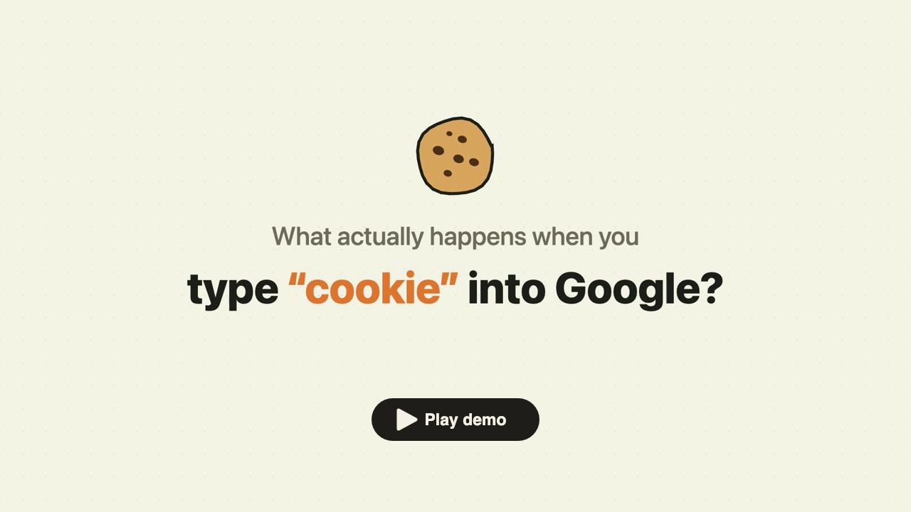

<p align="center">
  
</p>

<h1 align="center">under the hood</h1>

<p align="center">
  Animated, narrated "what actually happens when..." explainer videos, made by Claude Code.<br>
  Give it a topic or your code. Get a 1080p MP4 with hand-drawn animation, narration, music and sound effects.
</p>

<p align="center">
  <a href="docs/demo.mp4"></a>
  <br>
  <video src="https://github.com/Rajesh-Royal/under-the-hood/raw/main/docs/demo.mp4" poster="https://github.com/Rajesh-Royal/under-the-hood/raw/main/docs/demo-poster.jpg" width="720" controls></video>
  <br>
  <sub>Made with this skill: what actually happens when you type "cookie" into Google. Turn the sound on. The narration is a cloned voice, generated locally.</sub>
</p>

## Install

In Claude Code:

```
/plugin marketplace add Rajesh-Royal/under-the-hood
/plugin install under-the-hood@under-the-hood
```

Or without the plugin system, copy both skill folders into your personal skills:

```bash
git clone https://github.com/Rajesh-Royal/under-the-hood.git
cp -R under-the-hood/skills/under-the-hood under-the-hood/skills/under-the-hood-setup ~/.claude/skills/
```

## Use

```
/under-the-hood:under-the-hood what happens when you git push
```

With the manual install, the command is `/under-the-hood`. You can also just ask in plain words, like *"make an under-the-hood video about how HTTPS works"* or *"make an explainer video of how this auth flow works"*, and Claude picks the skill up.

What happens next:

1. **Setup check.** The first run detects your OS and installs what's missing. It asks before any `brew`, `apt` or `sudo` command. Later runs do a one-line check and move on.
2. **A couple of questions**, only if needed: which angle on a broad topic, and which voice (built-in, your own, or none).
3. **Script and storyboard.** You approve the narration and scenes before anything is rendered.
4. **Build and check.** Claude writes the animation, screenshots every scene and fixes overlaps.
5. **Narration.** It generates two takes per line locally. You listen and pick, line by line if you like.
6. **Render.** It produces a 1080p30 MP4 with ducked music, synced sound effects and loudness set for social platforms (-16 LUFS).

A 60-second video renders in about 30 seconds on an M-series Mac.

## Requirements

- Tested on macOS (Apple Silicon). Linux and WSL should work but are untested so far. Native Windows isn't supported.
- `ffmpeg`, Node 18+, `python3` and [`uv`](https://docs.astral.sh/uv/). The setup skill installs them with your okay.
- 2 GB or more of disk for the TTS environment and model weights (more on Linux with CUDA). Videos without narration skip this.

Everything is installed into `~/.local/share/under-the-hood` (override with `UTH_HOME`). Nothing is written into your projects except the videos you make.

## Your own voice

Every run asks which voice to use. Pick "my own voice" and Claude gives you a short paragraph to read and a few recording tips. Record 20 to 30 seconds on your phone in a quiet room, talking the way you would explain something to a friend, and send the file. It gets cleaned up and saved, so later videos can reuse it.

Voice cloning runs locally with [Chatterbox](https://github.com/resemble-ai/chatterbox), and your recording never leaves your machine. Only clone your own voice, or a voice you have permission to use. Chatterbox adds an inaudible watermark to all generated audio.

## How it works

- **Animation:** each video is a small canvas page (`engine.js` plus a per-topic `scenes.js`). Frames are rendered deterministically in headless Chrome, so every render is pixel-identical.
- **Timing:** narration clips decide each scene's length. The engine stretches the animation to fit, so editing a line re-syncs everything.
- **Sound:** music and sound effects are synthesized in code with Web Audio and timed from the same timeline as the visuals. There are no sample files and no licensing questions.
- **Mix:** ffmpeg ducks the music under the voice, adds a limiter and normalizes loudness.

You can open each project's `index.html` to preview it with chapters and scrubbing.

```
skills/
  under-the-hood/          the main skill: workflow, engine, templates, scripts
  under-the-hood-setup/    loaded only when something is missing, so it costs no context once set up
```

## Credits

- [Chatterbox](https://github.com/resemble-ai/chatterbox) by Resemble AI (MIT) for local text to speech and voice cloning
- [Playwright](https://playwright.dev) for driving headless Chrome
- [FFmpeg](https://ffmpeg.org) for encoding and mixing

## License

MIT. See [LICENSE](LICENSE).
